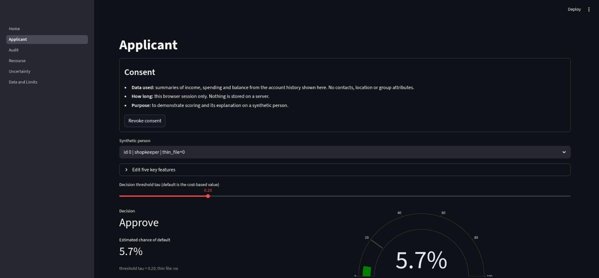
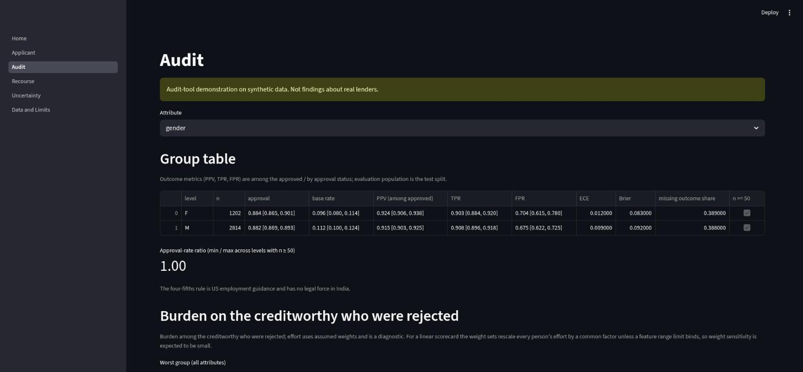
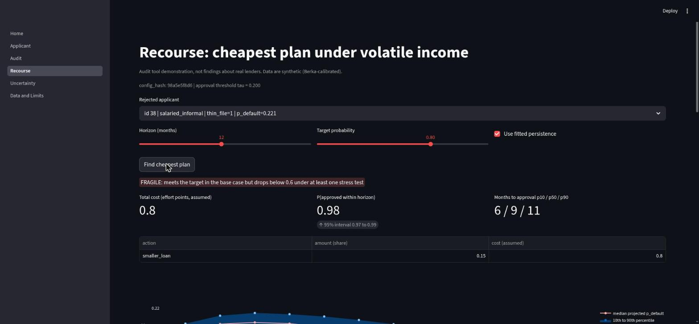

# SecondLook: audit-first credit scoring for people with thin credit files

**Status: audit-tool demonstration on synthetic data. Not a lending decision tool. Nothing here is a finding about real lenders.**

SPHINX'26 24-hour hackathon, MNIT Jaipur. Team NexusNavigators.

## 1. Problem statement 3.4

Gig workers, shopkeepers and students often have no credit history and are rejected by default. The task: build a score from rent, utility, recharge and cash-flow signals, check fairness across groups, use synthetic data with a consent-based design, and (bonus) provide a bias audit panel.

> **3.4 Alternative Credit Scoring for the Credit-Invisible.** Problem: Gig workers, small shopkeepers and students have no credit history, so formal lenders reject them even when they are reliable. Target users: Microfinance lenders, NBFCs, informal workers. Approach: Build a score from alternative signals such as rent, utility and mobile-recharge payment patterns and cash-flow consistency, with fairness checks across groups. Stack: scikit-learn, SHAP, FastAPI, Streamlit. Use synthetic data with consent-based design. Bonus twist: Bias audit panel comparing approval rates across demographics.

## 2. What SecondLook adds

A plain cash-flow score is the easy part. SecondLook scores people and then audits the score:

1. **Burden.** Among creditworthy people who were rejected, which group has to change the most to be approved?
2. **Uncertainty.** How sure is the score on thin files? Unsure cases are referred to a person (conformal sets).
3. **Volatility-aware plan.** Which repayment plan still works when income is volatile? We simulate many income futures and report the probability of approval, not a single instruction.
4. **No labels.** What can be said about group gaps when group labels are missing? Bounds, and they are wide when the proxy is weak.

## 3. Screenshots

Screenshots from the running app (synthetic data):







## 4. Data

- **Simulator with hidden ground truth.** Default depends on a simulated post-loan shortfall (unobserved expense shocks), never on a group label. Income is a persistent, volatile log-income process by occupation.
- **Berka calibration.** Parts of the generator are calibrated on the Berka Czech bank dataset (see `docs/DATASHEET.md`). The data are **not Indian data**.
- **Four injected biases** (switch `BIAS_FLAGS` in `src/secondlook/config.py`, off for a control run): noisier and lower rent/utility/recharge signals for shared-phone or document-poor people; higher income volatility for women in gig work; a planted gender proxy (`night_active_share`); a planted region proxy (`local_market_share`). The planted proxies have no effect on true risk.

| Item | Status |
|---|---|
| Income, balances, volatility, shocks | simulated, calibrated on Berka where noted in the datasheet |
| Default outcome | simulated from hidden shocks |
| Rent, utility, recharge on-time signals | **assumed** to predict default; no paper we read shows it |
| Night-active and local-market shares | **assumed**, planted proxies |
| Recourse action costs and levels | **assumed** (`src/secondlook/recourse/actions.py`) |
| Berka loans | real (Czech, 1990s), used for calibration and a sanity run only |

No caste or religion attribute exists anywhere.

## 5. Architecture

```
Berka (calibration) --> sim/ generator --> data/synth/*.parquet
                                              |
                          model/ scorecard (logistic, calibrated, cost-based tau)
                              |            |             |
                       audit/ (burden,  uncertainty/   recourse/ (AR(1) income,
                       proxy, no-label) (conformal)    Monte Carlo, stress tests)
                              \            |             /
                       Streamlit app (app/) + FastAPI (src/secondlook/api)
```

## 6. How to run

**One command:** `bash scripts/start.sh`. It builds the data, model and audit results if they are missing (about 7 minutes; `FAST=1` shortens it), then serves the app at http://localhost:8501 and the API at http://localhost:8000/docs. Ctrl-C stops both. Set `PYTHON=/path/to/python` to choose the interpreter. The step-by-step commands are below.

```
git clone <repo> && cd SecondLook
export PYTHONPATH=src                # Python 3.14, packages as in requirements.txt
bash scripts/fetch_berka.sh          # optional: downloads the Berka dump
# run these four in order: each needs the files written by the one before
python scripts/make_data.py          # synthetic people and cash flows -> data/synth
python scripts/train.py              # scorer and calibration -> artefacts/
python scripts/run_recourse.py       # needs the model
python scripts/run_audit.py          # needs the model; about 5 minutes (--fast skips the bootstrap)
streamlit run app/Home.py            # http://localhost:8501
uvicorn secondlook.api.main:app --port 8000   # docs at http://localhost:8000/docs
pytest -q                            # 62 tests, about 2 minutes
```

Packages: numpy, scipy, pandas, pyarrow, scikit-learn, xgboost, statsmodels, fastapi, uvicorn, streamlit, plotly, pydantic, joblib, pytest; optional shap, fairlearn, mapie. For quick work before real data exists: `python scripts/make_fixtures.py`, then `export SL_DATA=data/fixtures/synth SL_ART=data/fixtures/artefacts` (random numbers in the correct schema).

These commands (without the optional Berka download) were run in a fresh clone on 31 Oct 2026: data generation, training, recourse, audit and 58 passing tests.

### Recourse in one paragraph

A rejected applicant asks what to change over the next H months. Income is fitted as an AR(1) process on log inflow using only the months the model sees (thin files: 3 to 5), with shrinkage towards an occupation prior. For each of 81 candidate plans (cut spending, extra income, on-time payments, smaller loan) we draw 500 to 1000 income paths with common random numbers, rescore each month with the same model, and record the first month with `p_default <= tau`. We return the cheapest plan whose probability of approval within H months reaches the target (default 0.8), a fan chart, and four stress tests (volatility drift, stricter threshold, removing the assumed on-time signals, income persistence). A plan is flagged fragile if it meets the target but falls below 0.6 under any stress. It is a model-conditional probability on synthetic data.

### Extra checks

- **Control run (biases off):** `bash scripts/run_control.sh`. With the four injected biases off, the failure flags, the unexplained gap and the planted-proxy detection go quiet and the worst-to-best burden ratio falls from 2.29 to 1.56. One caveat: the null-world check is quiet at tau 0.20 or higher but raises false alarms at stricter thresholds (0.10 and 0.15), for either scorer. See `docs/CONTROL_RUN.md`.
- **Booster comparison:** `python scripts/run_booster.py` fits a monotone-constrained XGBoost model on the same splits and features. On our data it is no more accurate than the scorecard (test AUC 0.705 vs 0.707), and its SHAP stability over 10 bootstrap refits is not clearly better than the coefficients'. The scorecard stays the main model. See `docs/BOOSTER_COMPARISON.md`.
- **Recourse retraining stress:** plans are also tested against the lender retraining its scorer on drifted data during the plan (five bootstrap refits, each with its own threshold). It is reported as `retrain` and counted in the fragile flag. See `docs/RETRAIN_STRESS.md`.
- **Live API check:** `python scripts/check_api_live.py` starts a real uvicorn server and calls all eight endpoints over HTTP (all returned 200 on 31 Oct 2026).
- **Gamma sensitivity (Uncertainty page):** a slider that re-weights the exploration weights adversarially to show how far weighted conformal coverage could fall if the lender's approvals were confounded. It is a sensitivity analysis, not a guarantee. Coverage falls steadily as Gamma grows.
- **Intersection scan (Audit page):** pairs of attributes are scanned for the burden on creditworthy rejected people and the approval rate. Cells under 50 are skipped and the number of cells examined is reported, so the worst cells are leads, not findings.
- **Informative on-time signals (off by default):** `SL_ON_TIME_LOAD=0.07` makes the rent, utility and recharge signals carry hidden-risk information, so the on-time recourse lever and the gaming test act on the score. It raises test AUC to 0.72, but the null-world check then fails at the lower threshold, so we keep it off. See `docs/ON_TIME_VARIANT.md`.
- **One command and a container:** `bash scripts/run_all.sh` runs the four pipeline steps. A `Dockerfile` is included but the image has **not been built or tested** (`docs/DOCKER.md`).
- **No-label bounds:** the linear programme now has the paper's closed form (Kallus, Mao and Zhou, demographic-disparity set) beside it, and a test checks that the two agree. Their estimation and inference procedure is not implemented, so the bounds carry no sampling uncertainty.

## 7. Stack

scikit-learn, FastAPI, Streamlit, plotly, XGBoost (optional), SHAP (optional).

## 8. Team

Harshit Jangir (leader), Nikhil Saini, Shreya Chaudhary, Maulik Pratap Singhal.

## 9. Limits and claims we do not make

- Data are synthetic or Berka (Czech), not Indian.
- Rent, utility and recharge signals are assumed. In the current trained model the three on-time features were dropped by feature selection, so the recourse "on-time" action and the "gaming" stress test have no effect on the score (`artefacts/metrics.json`, `dropped_features`). An optional simulator variant that makes them informative exists but is off by default (`docs/ON_TIME_VARIANT.md`).
- No validation on Indian thin-file borrowers.
- Burden and effort are diagnostics, not targets. Recourse costs are assumptions in effort points.
- The four-fifths rule has no legal force in India.
- No compliance claim for RBI FREE-AI or DPDP.
- No claim that borrowers or loan officers understand reason codes or conformal sets.
- Post-processing fairness mitigation is not implemented.
- Recourse reveals how the score reacts to behaviour; real deployments must consider misuse and model extraction.
- Any bias found is a property of the injected generator, not of the world.

## 10. Attribution

scikit-learn, XGBoost, FastAPI, Streamlit, plotly. Berka: P. Berka, PKDD'99 discovery challenge, obtained from the CTU Prague Relational Learning Repository; Motl and Schulte, "The CTU Prague Relational Learning Repository", arXiv:1511.03086. Methods adapted (reimplemented, no code copied): Fang et al. 2607.28847, Barrainkua et al. 2509.04128, De Toni et al. 2410.08007, Plecko 2605.11373, Kallus, Mao and Zhou 1906.00285, Tibshirani et al. (conformal under covariate shift), Scarone and Baeza-Yates 2606.18479.

The arXiv ids above were checked against the arXiv listing titles on 31 Oct 2026: 2607.28847 Effort-Centric Fairness in Lending Decisions; 2509.04128 Revisiting (Un)Fairness in Recourse by Minimizing Worst-Case Social Burden; 2410.08007 Time Can Invalidate Algorithmic Recourse; 2605.11373 Causal Algorithmic Recourse: Foundations and Methods; 1906.00285 Assessing Algorithmic Fairness with Unobserved Protected Class Using Data Combination; 2606.18479 The Illusion of Improvement: Reject Inference Strategies in Credit Scoring; 1511.03086 The CTU Prague Relational Learning Repository.

## 11. Licence and disclaimer

Code and documents: MIT, see `LICENSE`. The Berka dataset is not included and keeps its own terms (the repository it comes from states no licence). **Audit tool demonstration, not findings about real lenders.**
